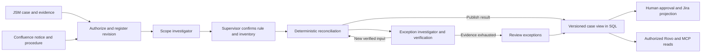

# Payer Correction Review — system design

**Design baseline, November 22, 2026.** One Forge installation owns one organization's case data. A Jira issue anchors the collaboration; a versioned reconciliation result is the financial source for the app. The hackathon environment operates on synthetic data. See [requirements and worked fixture](PRD.md), [autonomous workflow schema](AUTOMATION-SCHEMA.md), and [release gates](ROADMAP.md).

## Components and request paths

| Component | Choice and responsibility |
|---|---|
| Client | React, Vite, TypeScript, Atlassian Design System and Forge Custom UI. Internal issue panel for counts and approval status; full-page workspace for scope review, paginated exceptions and evidence timeline. Poll by revision while work is pending. |
| Identity and commands | Forge bridge invokes typed resolvers. Resolve installation, caller and issue access on the server; enforce mapped app roles and Jira permissions. Require expected revision for every consequential command. |
| Workflow | Node.js 24 Forge Functions, product triggers, scheduled recovery, and bounded queues via Async Events. LangGraph.js selects investigator steps and tool calls within a bounded worker invocation. Forge SQL persists the case/revision/stage state across invocations; do not rely on LangGraph's in-memory checkpointer. Use a job per case/revision/stage with bounded parallelism across exceptions. |
| Investigator runtime | OpenAI Responses API, Zod schemas, versioned prompts and an allowlisted tool dispatcher. Start with a low-cost model for extraction and promote disputed notice interpretation to a stronger model only when evaluation justifies it. Pin the evaluated model ID per release. The API key exists only as an encrypted Forge backend variable. Apply per-run call/token budgets and an OpenAI project hard spend limit. |
| Domain core | A pure TypeScript library maps evidence to typed outcomes and integer USD cents. The same code runs behind Forge and offline fixture replay. |
| Persistence | Forge SQL and parameterized queries for bounded case records. Versioned migrations, tenant-isolated storage, paginated reads. Verify the installed database schema before starting new jobs. |
| Integration | Jira REST v3 for issue state, JSM REST for internal request context, Confluence REST v2 for authorized page/version reads. Jira required, Confluence optional. Rovo reads results through Forge actions. A read-only MCP server reuses those actions. |
| Observability | Case-level decision history and structured Forge logs are required. Langfuse is optional developer telemetry on synthetic cases, with metadata-only traces; the application does not rely on Langfuse to complete work. |
| Delivery | npm workspaces for domain, contracts, Forge adapters, UI and fixtures. Vitest, fast-check, React Testing Library and Playwright. GitHub Actions CI. Develop in the local Codex workspace and use GitHub for pull, commit and push. Distinct Forge development, staging and production environments. |

Runtime and limits: [Node](https://developer.atlassian.com/platform/forge/function-reference/nodejs-runtime/), [Async Events](https://developer.atlassian.com/platform/forge/runtime-reference/async-events-api/), [SQL limits](https://developer.atlassian.com/platform/forge/limits-sql/), [OpenAI API](https://developers.openai.com/api/reference/overview), [app compatibility](https://developer.atlassian.com/platform/forge/app-compatibility/).

## Inputs, storage and financial invariants

| Record | Minimum fields and invariant |
|---|---|
| Case and published revision | Jira issue ID, project, scope revision, active input fingerprint, published result ID, review state and pending Jira projection. Publish with a conditional revision update. |
| Source and inventory manifest | Type, schema version, provider/payer, source version and hash, effective period, provenance/visibility, counts, coverage declaration and supersedes reference. Expectation comes from independently supplied inventory plus approved scope. |
| Expected line | Stable provider claim/line ID, payer, plan, service date, original reference, approved expected net amount and currency. Unique within scope revision. Multiple possible identities are an exception. |
| Remittance event | Source batch, stable event identity, original/replacement reference, level, signed amount, effective ordering and content hash. Distinct events may legitimately share amounts. A repeated ID with different content is quarantined. |
| Decision / exception | Case revision, line, status, observed net, expected net, reason code, evidence IDs, rule version, and prior decision. Show an unknown expectation explicitly. |
| Run / approval / effect | Run ID, stage, source and prompt versions, tool outcomes, retry state, reviewer decision and time, idempotency key and Jira sync receipt. Append review history with access and retention controls. |

The seed adapter accepts allowlisted, schema-validated synthetic fixture variants, including an incomplete manifest. Additional fixture amounts/dates may be changed through validated controls. Record input hashes and row-level event identities: a reordered file or overlapping batch can contain previously seen events even with a different file hash.

1. Freeze the inventory, approved population rule, remittance sources and cutoff time for a candidate revision. Validate counts and reference integrity before calculation. Unsupported currencies, payment rules or incomplete sources stay unresolved.
2. Apply the confirmed predicate to inventory independently of payment rows. Match only supported exact identifiers and explicit reference chains. Flag ambiguous, dangling or conflicting references. Out-of-order branches stay pending until sufficient evidence arrives.
3. Apply the adapter's documented signed-event semantics. A $100 replacement, a $100 reversal of it, and a $100 reissue net to $100. Never add a provider-level adjustment to an arbitrary line. The demo supports full reversals and replacements with explicit references; quarantine other semantics until a domain-approved adapter supports them.
4. Classify each in-scope line once; report unknown/out-of-scope evidence separately. Distinguish missing evidence from a verified $0 payment. Verify the result covers the full expected set. A superseding scope or late reversal schedules recomputation of dependent results; a full recompute is the reference implementation for testing incremental updates.

## Durable orchestration

Use separate states for **investigation** (queued, running, waiting for evidence, waiting for scope approval, complete, failed) and **case review** (open, eligible, closed, reopened). An agent finishing its run confers no financial sign-off. A changed input marks the published result stale immediately; readers see the last confirmed revision and pending work.

Each worker receives installation-scoped IDs, checks allowed project and job revision, and uses a bounded lease. Stage immutable output rows under a candidate revision. Publish only after verifying manifest completeness, using a single conditional update on the case row. Keep the intended Jira projection in that row at publication. This accommodates Forge SQL's single-query statements and lack of foreign keys. Abandoned candidate rows remain invisible and expire under a cleanup job.

**LangGraph boundary.** A graph invocation may autonomously plan and use allowlisted evidence tools, but it finishes or yields within one Forge async consumer invocation. The durable outer controller records its state in SQL and queues the next stage. This is an architectural decision until a deployed spike proves LangGraph packaging, OpenAI calls, and resume behavior in Forge. A custom SQL checkpointer is optional; it must not become a prerequisite for the core reconciliation path. Forge Workflows is currently unavailable/EAP, so the build uses Async Events. [Forge Workflows status](https://developer.atlassian.com/platform/forge/runtime-reference/workflows-api/)

The projection worker updates the existing issue with a target status/revision, reads back the projection, and records completion. On a timeout it checks current state before retrying. If an analyst changed the workflow meanwhile, surface a sync conflict for resolution. Prefer setting an owned field or issue property to a stable value over appending comments. Never treat a timed-out create or transition as known failure. Recover stale leases, unfinished projections and incomplete queue dispatch from a scheduled sweep. The queue has at-least-once delivery and a finite retention window. Keep rate-limit backoff, a visible failed-jobs list, and operator replay keyed to the same inputs.

## Agents as workers and users

| Actor | Available tools | Escalation / autonomy limit |
|---|---|---|
| Intake agent | Read opted-in JSM/Jira incident and source manifest; classify request and detect missing inputs | Starts automatically on configured events. Cannot define the expected cohort from remittances alone. |
| Scope investigator | Read case-bound notice/procedure versions, inspect manifest, propose structured predicate with supporting spans | Propose only. Invalid citations, contradictory dates, or unsupported predicates request human review. |
| Exception investigator | Look up original reference, inspect authorized batch manifest, follow a replacement chain, request bounded recomputation | Default maximum three evidence lookups per unresolved group before returning findings. Group equivalent exceptions to avoid one LLM call per line. New financial facts must pass the deterministic adapter. |
| Verification agent | Reread published revision, source IDs and Jira projection; compare actual state to intended state | May retry or open a sync exception; cannot approve financial closure. |
| Rovo case assistant | Case summary, exception list and revision difference | Cites source references and states evidence limits. May suggest a human next step. Its output cannot alter the ledger or approve closure. |
| Consuming agent | Same three versioned read tools exposed by one Forge MCP module | Example: a provider-relations assistant checks what changed before drafting an internal briefing. Use delegated user access and explicit site opt-in. Deny any invocation without verifiable caller context. |

The scope and exception investigators are application workers using model/tool loops. Forge owns the scheduler and tool permissions. Their coordination does not depend on invoking Rovo agents recursively. Treat source text as untrusted evidence. Validate tool selections, IDs, inputs and model outputs server-side. Missing, fabricated or inaccessible citations produce an unresolved finding.

**Authority:** Agents may read permitted sources, propose scope, classify discrepancies, create an internal follow-up packet, and project an approved result into Jira. A supervisor alone confirms the population/expected-payment basis and approves closure of a current revision. The app may then project that approved closure into Jira and verify it. No agent contacts a payer, updates patient balances, or silently closes an unapproved financial case. This is autonomous investigation and execution within a bounded authority, not an unattended financial adjudicator.

### Agent API contract, version 1

Implement a shared application API behind Forge resolvers, Rovo actions and MCP. The release exposes authenticated tools through Forge; it requires no public HTTP service, API keys, or bespoke OAuth server. A future provider-side ingestion API requires its own trust agreement and design.

| Read-only tool | Request | Response |
|---|---|---|
| `get-case-summary` | `caseId`, optional `revision` | `scopeCoverage`, counts, known exposure in integer cents, currency, adjudication basis, closure state, input freshness |
| `list-case-exceptions` | `caseId, revision`, optional `status, cursor, limit` | Stable, paged exceptions with reason codes, needed evidence and visible source references; maximum 50 items |
| `get-case-changes` | `caseId, fromRevision, toRevision` | Changed decisions, causal event references, count/amount deltas, and whether prior approval was invalidated |

All successful tool responses include `schemaVersion, caseId, revision, asOf, runId`. Pin pagination to the requested revision. Validate opaque cursor binding to caller, case and filters. Use typed errors for invalid input, stale/unavailable revision, throttling (with retry hint), and unavailability. Unknown or inaccessible case IDs return the same external error. Redact restricted sources; if a derived conclusion would reveal their contents, withhold it as well. Provide a bounded structured envelope, serialized to JSON text where the action adapter requires it. Cache only within the same access context.

**Example.** In the worked fixture, the request `get-case-changes(caseId="DEMO-1", fromRevision=2, toRevision=3)` returns a change for synthetic line 07 from corrected to reversed, an unresolved delta of 10000 USD cents, and the reversal evidence reference. The caller sees that the supervisor approved revision 2 and that revision 3 requires review. A second agent with no access to DEMO-1 receives no counts, identifiers, or explanation.

The MCP module is Preview. Validate the supported caller identity and permission propagation on a clean installation before exposing tools. If the connector cannot prove caller authorization, disable it and retain the internal authorized app flow. Rovo actions invoked by automation have write restrictions. [Rovo MCP](https://developer.atlassian.com/platform/forge/manifest-reference/modules/rovo-mcp/) · [Actions](https://developer.atlassian.com/platform/forge/manifest-reference/modules/rovo-action/)

## Security, operations and release gates

- **Access.** Use Forge's verified invocation context, app installation boundary, case-level Jira visibility, and app role mapping. Recheck source permissions at read time. Separate customer-visible JSM surfaces from internal results. Bind background workers to installations, opted-in projects and authorized source sets. A permissions change invalidates cached derived content. Record minimal approval identity for accountability; measure performance at the case level.
- **Privacy.** The released judge workflow uses only generated synthetic records. Keep model input to authorized notice passages and minimal typed exception descriptors. Never send raw ERA files, patient identifiers, or hidden source text to Rovo/MCP. Logs carry opaque IDs and reason codes. Before any live pilot, review BAAs, feature eligibility, residency, retention/deletion, subprocessors, source licenses and access controls. Maintain real remittances within a provider-approved boundary; even pseudonymous data needs assessment. Rovo MCP is excluded from the HIPAA-enabled clinical-data path. [Atlassian HIPAA guide](https://support.atlassian.com/organization-administration/docs/the-hipaa-implementation-guide/) · [Rovo for HIPAA organizations](https://support.atlassian.com/organization-administration/docs/use-rovo-for-hipaa-organizations/)
- **External data flow.** Declare OpenAI and any optional Langfuse endpoint in the Forge manifest. The hackathon sends only synthetic case content to OpenAI. Do not send Teamwork Graph-derived context to an external model until Atlassian's current data-egress policy and customer permissions are verified. External egress can affect Runs on Atlassian eligibility. [Graph limitations](https://developer.atlassian.com/platform/teamwork-graph/limitations-and-considerations/) · [Forge egress](https://developer.atlassian.com/platform/forge/runtime-egress-permissions/)
- **Cost.** The project cash ceiling is $100 across paid resources; the user's existing $85 OpenAI API credits are excluded from new cash spend. Reserve cash for Codespaces/Forge/Rovo overages. Use a dedicated OpenAI project limit, disable automatic recharge if applicable, cap calls/tokens/tool loops per run, and stop new paid work before approaching the ceiling. Dashboard billing can lag, so app counters are a second control, not a guarantee. [OpenAI pricing](https://developers.openai.com/api/docs/pricing) · [Forge pricing](https://developer.atlassian.com/platform/forge/forge-platform-pricing/)
- **Observability.** Distinguish the analyst's decision trail from operator telemetry. Trace input revision, stage, tool, source IDs, result codes, model/prompt versions, tokens, cost, duration, retries and Jira sync outcome. Persist auditable facts and concise evidence-backed explanations. Never log private reasoning or full prompts. Alert on stalled jobs, stale projections, authorization failures and repeated model failures. Replay uses frozen inputs and recorded decisions; an intentional new model evaluation creates a separate run.
- **Capacity and recovery.** Initial design target: 300 synthetic lines per case, 5 concurrent cases per installation, p95 summary load under 2 seconds after publication, and p95 reconciliation within 60 seconds after scope confirmation for the 300-line fixture, excluding human waits. Measure under warm and cold conditions; show timestamps while work is queued. Chunk inserts/reads, cap evidence sizes, monitor tenant storage and refuse oversized imports before partial publication. Budget hosted SQL against its documented 1 GiB production ceiling. Test recoverability from source fixtures and a failed migration. Pilot volume, retention period, RTO/RPO and provider-side storage need buyer sign-off and a restore drill.
- **Evaluation.** Differentially test incremental and full replay. Use property tests for duplicate invariance, net arithmetic, out-of-order events with authoritative references, and stale-approval rejection. Withhold entire notice/fixture variants from prompt tuning. Track predicate and citation accuracy, unresolved-line recall, false closures, excess abstention, cost and turnaround. Include inaccessible sources, instruction-like notice text, worker crash, partial import, provider adjustment, and stale read-tool revisions. Test noisy warnings as well as missed discrepancies.
- **Failure behavior.** If the LLM is unavailable, retain the last verified state and permit supervisor-entered scope; label manual input. If Confluence is disconnected, demo with versioned synthetic notice/procedure and show the source mode. If Jira sync fails, surface pending status in the app and replay safely. Optional Teamwork Graph results are user-filtered discovery aids and never establish financial completeness. [Graph authorization](https://developer.atlassian.com/platform/teamwork-graph/curated-queries/)
